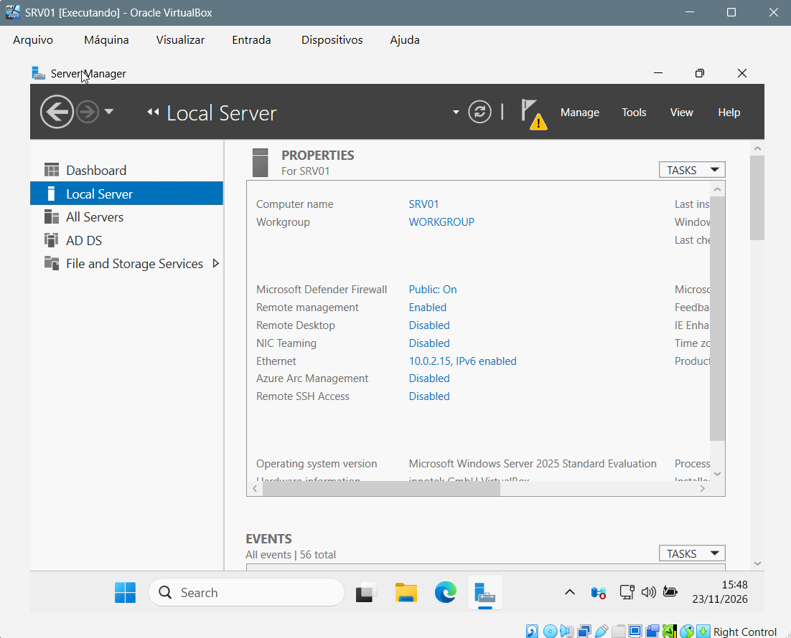
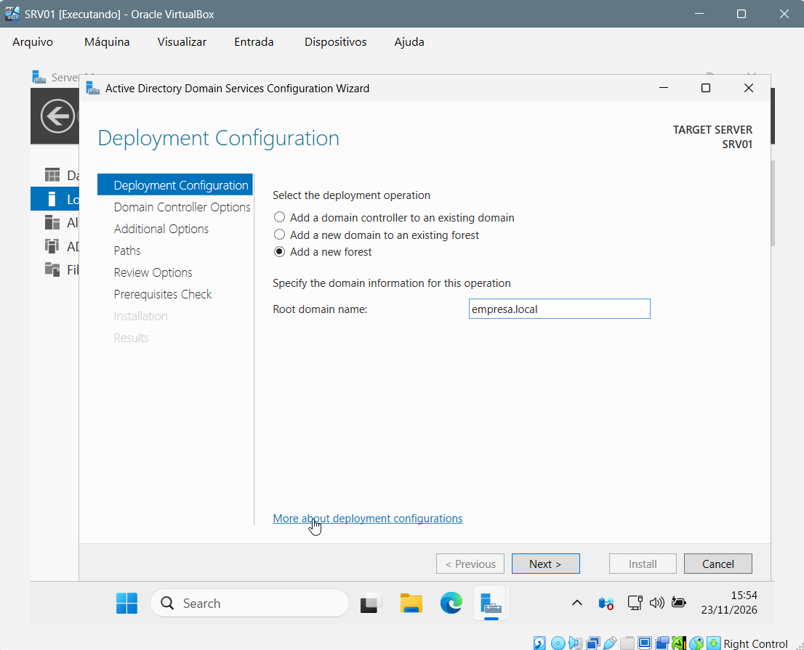
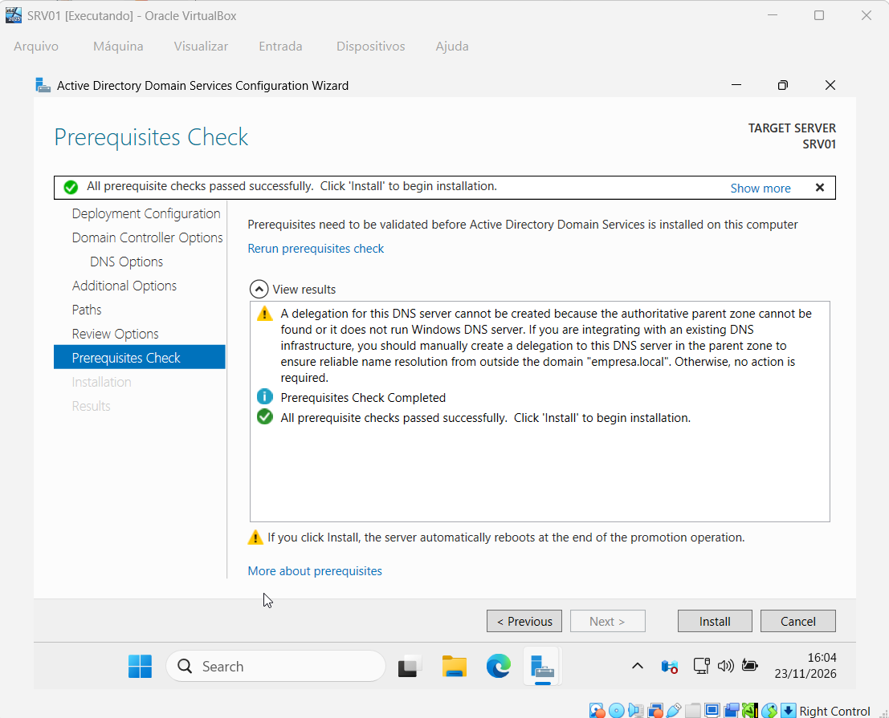
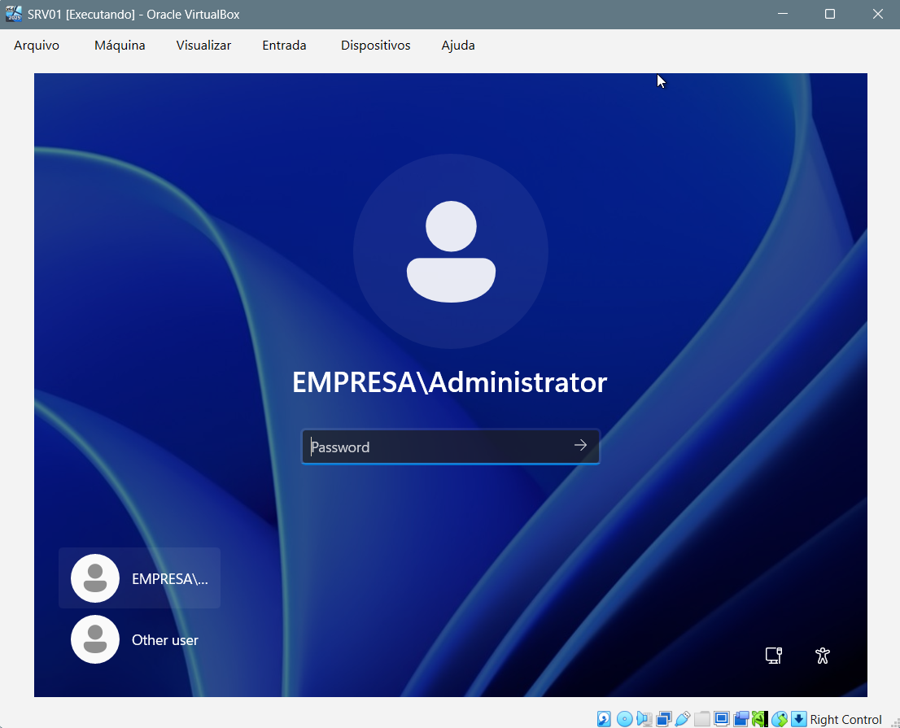

# Parte 1: Instalação do Windows Server e promoção a controlador de domínio

## Objetivo
Montar um servidor Windows em uma máquina virtual e transformá-lo em controlador de domínio do Active Directory, criando o domínio `empresa.local`. Ele é a base para praticar gerenciamento de usuários, senhas e acessos.

## Ambiente
- Notebook com Windows 11 e VirtualBox
- Máquina virtual `SRV01`: Windows Server 2025 Standard Evaluation (Desktop Experience)
  - 2 processadores (com PAE/NX), 4096 MB de memória e vídeo de 128 MB
  - Chipset ICH9, firmware UEFI e TPM 2.0 ativos
  - Disco virtual dinâmico de 25 GB e rede NAT
- Domínio: `empresa.local` (nome NetBIOS: `EMPRESA`)

## O que fiz

### Preparação do computador
1. Liberei espaço no disco do notebook com a Limpeza de Disco (`cleanmgr`, incluindo arquivos do sistema e do Windows Update) e apaguei de vez as máquinas virtuais antigas, ficando com mais de 38 GB livres.

### Máquina virtual e instalação
2. Criei a VM `SRV01` no VirtualBox com as configurações acima e montei o ISO oficial de avaliação do Windows Server 2025 na controladora SATA.
3. Iniciei a instalação pelo UEFI. Apaguei as partições antigas do disco virtual, o que converteu o disco para o padrão moderno GPT, e instalei a edição Standard Evaluation (Desktop Experience), que tem interface gráfica.
4. Defini a senha do Administrator seguindo a política de complexidade do Windows Server (maiúsculas, minúsculas, números e símbolos).
5. Instalei os Adicionais para Convidados do VirtualBox (drivers de vídeo, ajuste de resolução e área de transferência compartilhada).
6. Desmontei o ISO da VM e apaguei o arquivo `.iso` do computador, para recuperar espaço.

### Configuração base do servidor
7. Renomeei o servidor para `SRV01` (Gerenciador do Servidor > Servidor Local), antes de criar o domínio.
8. Troquei o endereço automático (DHCP) por um IP fixo na placa de rede, para o serviço ficar sempre no mesmo endereço:
   - Endereço IPv4: `10.0.2.15`
   - Máscara: `255.255.255.0`
   - Gateway: `10.0.2.2` (o roteador virtual do NAT)
   - DNS preferencial: `127.0.0.1` (o próprio servidor)
   - DNS alternativo: `8.8.8.8` (para a internet)

### Active Directory
9. Instalei a função Active Directory Domain Services (AD DS) e as ferramentas de administração (Gerenciador do Servidor > Gerenciar > Adicionar Funções e Recursos).
10. Promovi o servidor a controlador de domínio criando uma nova floresta, `empresa.local`, com o serviço de DNS instalado junto e o servidor como Catálogo Global. Defini também a senha do Modo de Restauração de Serviços de Diretório (DSRM).
11. A verificação de pré-requisitos passou, executei a instalação e, depois do reinício, entrei com a conta do domínio.

## Etapas e prints

### 1. Preparação do servidor

No Gerenciador do Servidor (Servidor Local) aparecem o nome do computador `SRV01`, o grupo de trabalho `WORKGROUP` (ainda fora de domínio), a placa de rede com o IP `10.0.2.15` e o sistema Windows Server 2025 Standard Evaluation.

### 2. Promoção a controlador de domínio

No assistente de configuração do AD DS, escolhi **Add a new forest** (adicionar uma nova floresta) e informei o nome do domínio raiz: `empresa.local`.

### 3. Verificação de pré-requisitos

O assistente mostrou **All prerequisite checks passed successfully** (todas as verificações passaram) e o botão **Install** liberado. Apareceu também um aviso sobre a delegação de DNS: ele diz que não foi possível criar a delegação porque a zona pai autoritativa não foi encontrada. Esse aviso é normal em um laboratório com um domínio novo e isolado, e o próprio texto diz que nenhuma ação é necessária. Outro aviso informa que o servidor reinicia automaticamente no final da promoção.

### 4. Login no domínio

Depois do reinício, a tela de login passou a mostrar **EMPRESA\Administrator**. Isso confirma que o servidor agora faz parte do domínio `empresa.local` como controlador de domínio.

## O que entendi
- **Active Directory (AD DS):** serviço da Microsoft que guarda as contas de usuários, grupos e computadores de uma empresa em um lugar central.
- **Domínio:** o conjunto de contas e computadores gerenciados juntos, aqui `empresa.local`.
- **Controlador de domínio:** o servidor que guarda o domínio e confere o login dos usuários.
- **Floresta:** o nível mais alto do AD. Uma nova floresta cria um domínio do zero.
- **Catálogo Global:** uma lista do AD que ajuda a achar objetos em todo o domínio.
- **DSRM:** a senha de emergência usada para restaurar o AD se ele der problema.
- **IP fixo:** um servidor precisa estar sempre no mesmo endereço, senão os outros computadores deixam de encontrá-lo.
- **DNS apontando para o próprio servidor (`127.0.0.1`):** o AD usa o DNS para se localizar, por isso o controlador de domínio deve consultar o próprio DNS primeiro.
- **Login `EMPRESA\Administrator`:** o formato é `DOMÍNIO\usuário`, e mostra que a conta é do domínio e não do computador.

## Erros que apareceram e como resolvi

**O VirtualBox não abriu e mostrou `Document is empty` no arquivo `VirtualBox.xml`.**
- Causa: o disco do notebook estava cheio, e o VirtualBox não conseguiu gravar o arquivo de configuração, que ficou vazio.
- Como resolvi: liberei espaço no disco e restaurei a configuração a partir do arquivo de cópia de segurança, o `VirtualBox.xml-prev`.
- Lição: o espaço livre no disco é uma condição para o VirtualBox funcionar. Vale conferir o espaço antes de criar ou ligar VMs, e saber que o VirtualBox guarda uma cópia (`-prev`) da configuração.

## O que aprendi
Nesta parte aprendi a montar um servidor Windows em máquina virtual e a transformá-lo em controlador de domínio do Active Directory. Entendi que o AD guarda as contas da empresa em um lugar central, que ele depende do DNS e que o servidor precisa de IP fixo. Vi que alguns avisos, como o da delegação de DNS, são normais em laboratório. Também aprendi, com o erro do VirtualBox, que falta de espaço em disco pode quebrar o ambiente de virtualização, e como recuperar a configuração a partir do backup. Agora tenho o domínio `empresa.local` pronto para criar usuários, grupos e controlar senhas e acessos, que é o dia a dia de um suporte N1.
