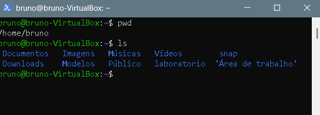
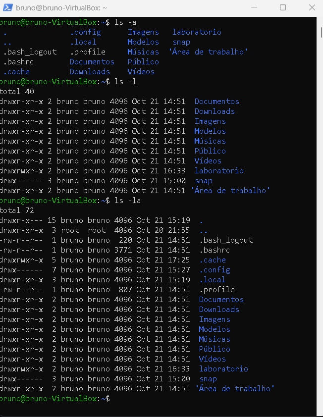

# Bloco 1: Onde estou e o que existe (pwd, ls, ls -a, ls -l, ls -la)

## Objetivo
Aprender a me localizar no terminal do Linux e a listar arquivos e pastas, inclusive os ocultos e com detalhes.

## Ambiente
- Ubuntu em uma máquina virtual (VirtualBox) no Windows 11
- Acesso à VM por SSH, pelo PowerShell
- Usuário: `bruno`

## Comandos e resultados

### 1. Ver em que pasta estou: `pwd`
```
bruno@bruno-VirtualBox:~$ pwd
/home/bruno
```
O que significa: mostra o caminho da pasta atual. `/home/bruno` é a pasta pessoal do meu usuário, e o `~` no prompt é um atalho para ela.

### 2. Listar o que existe: `ls`
```
bruno@bruno-VirtualBox:~$ ls
 Documentos   Imagens   Músicas   Vídeos        snap
 Downloads    Modelos   Público   laboratorio  'Área de trabalho'
```
O que significa: mostra os nomes das pastas e arquivos da pasta atual. `'Área de trabalho'` aparece entre aspas porque o nome tem espaço e acento.



### 3. Mostrar também os ocultos: `ls -a`
```
bruno@bruno-VirtualBox:~$ ls -a
 .              .bashrc   .local       Downloads   Músicas   laboratorio
 ..             .cache    .profile     Imagens     Público   snap
 .bash_logout   .config   Documentos   Modelos     Vídeos   'Área de trabalho'
```
O que significa: o `-a` (*all*) inclui os itens ocultos, que começam com ponto (`.bashrc`, `.config`). O `.` é a pasta atual e o `..` é a pasta de cima.

### 4. Mostrar os detalhes: `ls -l`
```
bruno@bruno-VirtualBox:~$ ls -l
total 40
drwxr-xr-x 2 bruno bruno 4096 Oct 21 14:51  Documentos
drwxr-xr-x 2 bruno bruno 4096 Oct 21 14:51  Downloads
...
drwxrwxr-x 2 bruno bruno 4096 Oct 21 15:11  laboratorio
drwx------ 3 bruno bruno 4096 Oct 21 15:00  snap
```
O que significa: o `-l` (*long*) mostra uma linha de detalhes para cada item.

### 5. Tudo junto: `ls -la`
```
bruno@bruno-VirtualBox:~$ ls -la
total 72
drwxr-x--- 15 bruno bruno 4096 Oct 21 15:19  .
drwxr-xr-x  3 root  root  4096 Oct 20 21:55  ..
-rw-r--r--  1 bruno bruno  220 Oct 21 14:51  .bash_logout
-rw-r--r--  1 bruno bruno 3771 Oct 21 14:51  .bashrc
drwxrwxr-x  5 bruno bruno 4096 Oct 21 15:20  .cache
drwx------  7 bruno bruno 4096 Oct 21 15:27  .config
drwxr-xr-x  3 bruno bruno 4096 Oct 21 15:19  .local
-rw-r--r--  1 bruno bruno  807 Oct 21 14:51  .profile
drwxr-xr-x  2 bruno bruno 4096 Oct 21 14:51  Documentos
...
```
O que significa: o `-la` junta os ocultos e os detalhes.



## Como ler uma linha do `ls -l`
Exemplo: `drwxr-xr-x 2 bruno bruno 4096 Oct 21 14:51 Documentos`

| Parte | Significado |
|---|---|
| `d` | é uma pasta (nos arquivos aparece `-`) |
| `rwx` | o dono pode ler (r), escrever (w) e executar (x) |
| `r-x` (primeiro) | o grupo pode ler e executar, mas não escrever |
| `r-x` (segundo) | os outros usuários também só leem e executam |
| `bruno bruno` | o dono e o grupo |
| `4096` | tamanho em bytes |
| `Oct 21 14:51` | data e hora da última modificação |
| `Documentos` | o nome |

Observações da minha saída:
- `.config` e `snap` têm `drwx------`: só o dono acessa.
- `.bashrc` e `.profile` são arquivos de configuração do meu terminal e usuário.
- `laboratorio` tem `drwxrwxr-x`: o dono e o grupo também podem escrever nela.

## Erros que apareceram e como resolvi
Nenhum erro neste bloco.

## O que aprendi
Neste bloco aprendi a me localizar no terminal. O `pwd` mostra em que pasta eu estou e o `ls` lista o que existe dentro dela. Aprendi que o `ls -a` mostra também os arquivos ocultos (os que começam com ponto), que o `ls -l` mostra os detalhes de cada item e que o `ls -la` junta os dois. Também aprendi a ler as permissões de uma linha do `ls -l`: a primeira letra diz se é pasta ou arquivo, e as letras `r`, `w` e `x` mostram quem pode ler, escrever e executar.
