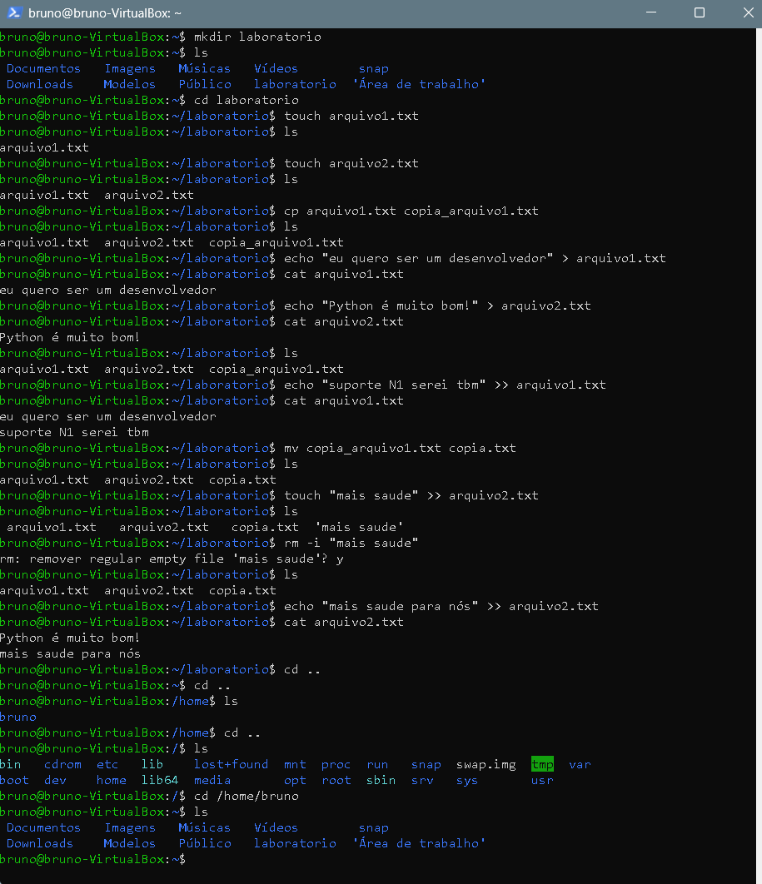

# Bloco 2: Criar, copiar, mover e apagar arquivos

## Objetivo
Aprender a criar, escrever, copiar, renomear e apagar arquivos no terminal do Linux, e a me movimentar entre as pastas do sistema.

## Ambiente
- Ubuntu em uma máquina virtual (VirtualBox) no Windows 11
- Acesso à VM por SSH, pelo PowerShell
- Pasta de treino: `/home/bruno/laboratorio`

## Resumo do treino
Criei uma pasta de treino, dois arquivos de texto e escrevi neles. Depois copiei, renomeei e apaguei com confirmação, e naveguei até a raiz do sistema (`/`) e voltei para a minha pasta pessoal.



## Comandos usados e resultados

### 1. Criar a pasta de treino e entrar nela
```
bruno@bruno-VirtualBox:~$ mkdir laboratorio
bruno@bruno-VirtualBox:~$ cd laboratorio
```
- `mkdir` cria uma pasta. `cd` entra nela.
- O prompt mudou para `~/laboratorio`, o que mostra que estou dentro dela.

### 2. Criar dois arquivos vazios
```
bruno@bruno-VirtualBox:~/laboratorio$ touch arquivo1.txt
bruno@bruno-VirtualBox:~/laboratorio$ touch arquivo2.txt
bruno@bruno-VirtualBox:~/laboratorio$ ls
arquivo1.txt  arquivo2.txt
```
- O `touch` cria um arquivo vazio, e o `ls` confirma que os dois existem.

### 3. Copiar um arquivo
```
bruno@bruno-VirtualBox:~/laboratorio$ cp arquivo1.txt copia_arquivo1.txt
bruno@bruno-VirtualBox:~/laboratorio$ ls
arquivo1.txt  arquivo2.txt  copia_arquivo1.txt
```
- O `cp origem destino` cria uma cópia. Fiz a cópia quando o `arquivo1.txt` ainda estava vazio, então a cópia guarda o conteúdo daquele momento.

### 4. Escrever texto nos arquivos
```
bruno@bruno-VirtualBox:~/laboratorio$ echo "eu quero ser um desenvolvedor" > arquivo1.txt
bruno@bruno-VirtualBox:~/laboratorio$ cat arquivo1.txt
eu quero ser um desenvolvedor
bruno@bruno-VirtualBox:~/laboratorio$ echo "Python é muito bom!" > arquivo2.txt
bruno@bruno-VirtualBox:~/laboratorio$ cat arquivo2.txt
Python é muito bom!
```
- O `echo "texto" > arquivo` escreve o texto no arquivo, apagando o que havia antes.
- O `cat` mostra o conteúdo, para eu conferir o que foi gravado.

### 5. Acrescentar uma linha sem apagar o resto
```
bruno@bruno-VirtualBox:~/laboratorio$ echo "suporte N1 serei tbm" >> arquivo1.txt
bruno@bruno-VirtualBox:~/laboratorio$ cat arquivo1.txt
eu quero ser um desenvolvedor
suporte N1 serei tbm
```
- O `>>` acrescenta no final do arquivo e mantém o que já estava lá. É a diferença para o `>`, que substitui.

### 6. Renomear um arquivo
```
bruno@bruno-VirtualBox:~/laboratorio$ mv copia_arquivo1.txt copia.txt
bruno@bruno-VirtualBox:~/laboratorio$ ls
arquivo1.txt  arquivo2.txt  copia.txt
```
- O `mv origem destino` move ou, na mesma pasta, renomeia. Aqui `copia_arquivo1.txt` virou `copia.txt`.

### 7. Apagar com confirmação
```
bruno@bruno-VirtualBox:~/laboratorio$ rm -i "mais saude"
rm: remover regular empty file 'mais saude'? y
bruno@bruno-VirtualBox:~/laboratorio$ ls
arquivo1.txt  arquivo2.txt  copia.txt
```
- O `rm` apaga sem lixeira. O `-i` pergunta antes, e eu respondi `y`.
- O nome tem espaço, então precisa ficar entre aspas.

### 8. Navegar entre as pastas
```
bruno@bruno-VirtualBox:~/laboratorio$ cd ..
bruno@bruno-VirtualBox:~$ cd ..
bruno@bruno-VirtualBox:/home$ ls
bruno
bruno@bruno-VirtualBox:/home$ cd ..
bruno@bruno-VirtualBox:/$ ls
bin   cdrom  etc   lib    lost+found  mnt  proc  run   snap  swap.img  tmp  var
boot  dev    home  lib64  media       opt  root  sbin  srv   sys       usr
bruno@bruno-VirtualBox:/$ cd /home/bruno
bruno@bruno-VirtualBox:~$
```
- O `cd ..` sobe uma pasta. Subi de `laboratorio` até a raiz do sistema (`/`), que é a pasta mais de cima do Linux.
- Dentro de `/home` está a pasta de cada usuário. Ali só existe `bruno`.
- O `cd /home/bruno` volta direto pelo caminho completo, sem precisar descer pasta por pasta.

## O que entendi de cada parte
- **`touch` e `echo`:** o `touch` só cria o arquivo. Quem escreve o texto nele é o `echo`.
- **`>` e `>>`:** o `>` apaga o conteúdo anterior e escreve o novo. O `>>` acrescenta no final.
- **`cp` e `mv`:** o `cp` copia, e o `mv` move ou renomeia.
- **`rm -i`:** o `rm` não manda para a lixeira, então o `-i` pergunta antes de apagar.
- **Nomes com espaço:** precisam de aspas, senão o terminal acha que são vários nomes.
- **A raiz `/`:** ali ficam `home` (pastas dos usuários), `etc` (configurações), `bin` (programas) e `var` (logs e dados).

## Erros que apareceram e como resolvi

**1. Usei `touch` achando que ele escrevia texto.**
- O que fiz: `touch "mais saude" >> arquivo2.txt`.
- O que aconteceu: o `touch` criou um arquivo vazio chamado `mais saude`, e nada foi escrito no `arquivo2.txt`.
- Como resolvi: apaguei o arquivo sem querer com `rm -i "mais saude"` e usei `echo "mais saude para nós" >> arquivo2.txt`, que acrescentou a linha.
- Lição: `touch` cria arquivos, e `echo` escreve neles.

**2. Em outra sessão, apaguei a minha pasta pessoal sem querer.**
- O que fiz: `rm -r ~/laboratorio ~`, com um `~` a mais no final.
- O que aconteceu: o `~` é a pasta pessoal, e o `rm -r` apagou o conteúdo dela, sem lixeira.
- Como resolvi: restaurei os arquivos padrão com `cp -rn /etc/skel/. ~/` e recriei as pastas com `xdg-user-dirs-update`.
- Lição: apagar um alvo por vez, conferir com `ls` antes e usar `rm -i`.

## O que aprendi
Neste bloco aprendi a criar, copiar, renomear e apagar arquivos. Vi que o `touch` só cria o arquivo e que quem escreve o texto nele é o `echo`, e que o `>` substitui o conteúdo enquanto o `>>` acrescenta no final. Aprendi que o `rm` apaga sem lixeira, por isso passei a usar o `rm -i`, que pergunta antes de apagar.

Meus erros me ensinaram que nomes com espaço precisam ficar entre aspas e que um `~` esquecido no `rm -r` pode apagar a pasta pessoal. Por isso agora confiro com `ls` antes e apago um alvo por vez. Também aprendi a me mover pelas pastas com `cd ..` e com o caminho completo, até a raiz do sistema.
