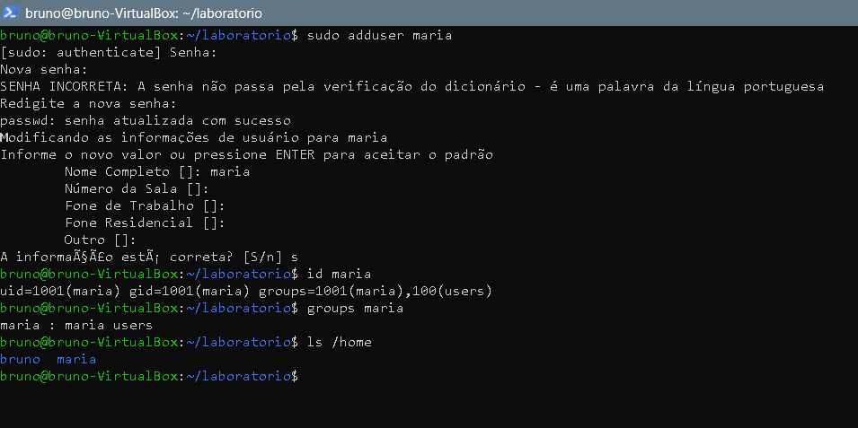
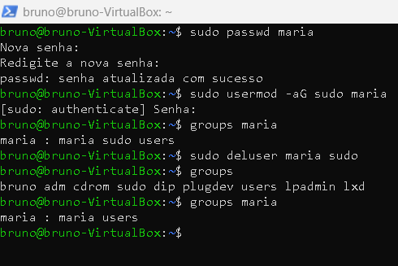
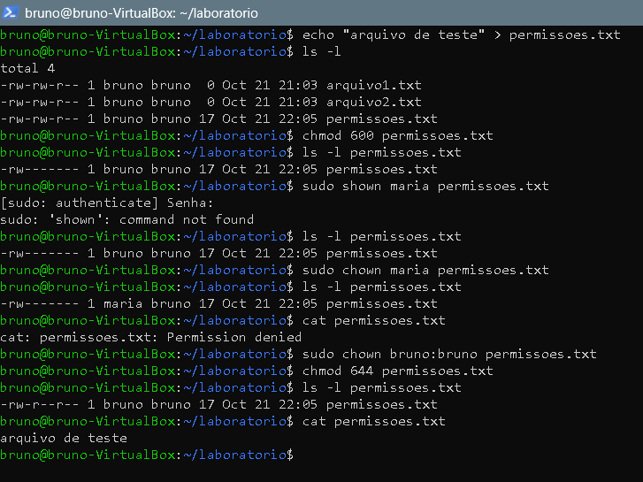

# Bloco 3: Usuários, grupos e permissões

## Objetivo
Praticar o que um suporte N1 faz no dia a dia com contas e acessos: criar um usuário, dar e tirar poder de administrador, e controlar quem pode ler e escrever em um arquivo.

## Ambiente
- Ubuntu em uma máquina virtual (VirtualBox) no Windows 11
- Acesso à VM por SSH, pelo PowerShell
- Usuário administrador: `bruno`. Usuária de teste: `maria`

## Parte B: criar um usuário

```
sudo adduser maria
id maria
groups maria
ls /home
```

- `sudo adduser maria` cria o usuário `maria`, com pasta pessoal. O `sudo` roda o comando como administrador. O terminal pediu uma senha para a Maria (digitada duas vezes) e depois dados opcionais (nome, telefone), que passei com Enter, e confirmei no final.
- `id maria` e `groups maria` mostram o número e os grupos da Maria.
- `ls /home` lista as pastas pessoais. Apareceram a do `bruno` e a da `maria`, o que mostra que o sistema criou a pasta da nova usuária.



## Parte C1: dar e tirar poder de administrador

```
sudo usermod -aG sudo maria
groups maria
sudo deluser maria sudo
groups maria
```

- `usermod -aG sudo maria` adiciona a Maria ao grupo `sudo`, o grupo dos administradores. O `-a` acrescenta (sem ele, a Maria sairia dos outros grupos) e o `-G` indica que é um grupo.
- `groups maria` confirma os grupos dela.
- `deluser maria sudo` tira a Maria do grupo `sudo`. Depois disso, o `groups maria` mostrou que ela voltou a ficar fora do grupo de administradores, só no grupo `users`.



## Parte C2: permissões de arquivo

```
cd ~/laboratorio
echo "arquivo de teste" > permissoes.txt
ls -l permissoes.txt
chmod 600 permissoes.txt
ls -l permissoes.txt
sudo chown maria permissoes.txt
ls -l permissoes.txt
cat permissoes.txt
sudo chown bruno:bruno permissoes.txt
chmod 644 permissoes.txt
ls -l permissoes.txt
cat permissoes.txt
```

- `chmod 600` deixa só o dono ler e escrever. Os números somam: 4 = ler, 2 = escrever, 1 = executar. O primeiro dígito é o dono, o segundo é o grupo e o terceiro são os outros. Então `600` = dono lê e escreve, grupo e outros não têm nada.
- `sudo chown maria permissoes.txt` passou o arquivo para a Maria. O `chown` troca o dono, e precisa de `sudo` porque estou dando o arquivo a outra pessoa.
- Ao tentar ler com `cat permissoes.txt`, apareceu **Permissão negada**: o arquivo agora era da Maria e só ela podia ler.
- `sudo chown bruno:bruno permissoes.txt` devolveu o arquivo para mim (dono `bruno`, grupo `bruno`).
- `chmod 644 permissoes.txt` deixou o dono com leitura e escrita (6) e todos os outros só com leitura (4).
- Conferi com `ls -l` e o `cat` voltou a mostrar o texto `arquivo de teste`.



## Erros que apareceram e como resolvi

**Digitei o comando `chown` errado na primeira vez.**
- O que aconteceu: o terminal disse que o comando era inválido.
- Como resolvi: reli o que digitei e corrigi para `sudo chown maria permissoes.txt`, e funcionou.
- Lição: quando o terminal reclama de um comando, o mais comum é um erro de digitação. Releio o comando letra por letra antes de tentar outra coisa.

## O que aprendi
Neste bloco aprendi a criar um usuário, a dar e tirar poder de administrador com o grupo `sudo`, e a controlar o acesso a um arquivo. Vi que o `chmod` muda quem pode ler, escrever e executar, e que o `chown` muda o dono. Vi na prática o erro **Permissão negada** quando um arquivo é de outro usuário, e como liberar o acesso de novo. Também aprendi que o `usermod -aG` precisa do `-a`, senão o usuário perde os outros grupos, e que um usuário deve ter só o acesso de que precisa.
