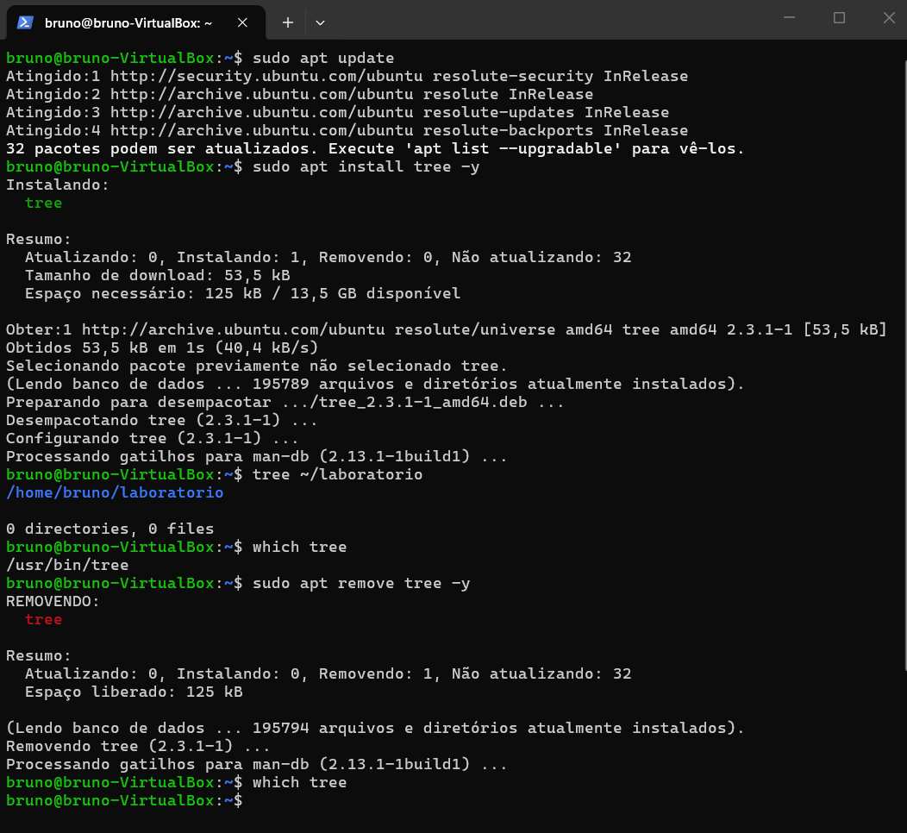
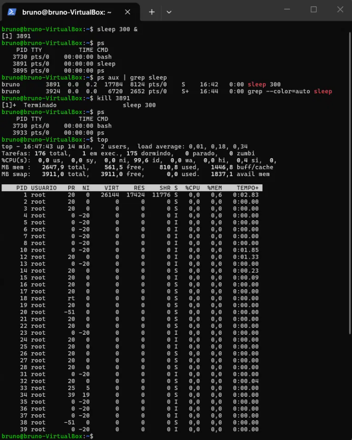

# Bloco 4: Programas, processos e serviços

## Objetivo
Praticar três tarefas comuns de um suporte N1: instalar e remover programas, encontrar e encerrar um programa que está rodando, e acompanhar o que o sistema está usando.

## Ambiente
- Ubuntu em uma máquina virtual (VirtualBox) no Windows 11
- Acesso à VM por SSH, pelo PowerShell
- Usuário: `bruno`

## Parte A: instalar e remover um programa

Usei o `apt`, o gerenciador de programas do Ubuntu, para instalar e depois remover o `tree`, um programa pequeno que mostra pastas em forma de árvore.

```
sudo apt update
sudo apt install tree -y
tree ~/laboratorio
which tree
sudo apt remove tree -y
which tree
```



O que cada comando fez e o que apareceu:

| Comando | O que faz | O que apareceu |
|---|---|---|
| `sudo apt update` | atualiza a lista de programas disponíveis, sem instalar nada | as linhas `Atingido` e a mensagem `32 pacotes podem ser atualizados` |
| `sudo apt install tree -y` | instala o `tree`, respondendo "sim" sozinho | `Instalando: tree`, download de 53,5 kB, e no fim `Configurando tree (2.3.1-1)` |
| `tree ~/laboratorio` | mostra a pasta `laboratorio` em árvore | `/home/bruno/laboratorio` e `0 directories, 0 files`, porque a pasta estava vazia |
| `which tree` | mostra onde o programa está instalado | `/usr/bin/tree` |
| `sudo apt remove tree -y` | desinstala o programa | `REMOVENDO: tree` e `Espaço liberado: 125 kB` |
| `which tree` (de novo) | confere se ele sumiu | nada apareceu, o que confirma que foi removido |

Observações:
- O `apt update` só **atualiza a lista**. Quem instala é o `apt install`.
- O `sudo` é necessário porque instalar e remover programas altera o sistema.
- O segundo `which tree` não mostrar nada é a prova de que a remoção funcionou.

## Parte B: processos

Um **processo** é um programa que está rodando, e cada um tem um número, o **PID**. Criei um processo de teste, encontrei o PID dele, encerrei e confirmei.

```
sleep 300 &
ps
ps aux | grep sleep
kill 3891
ps
top
```



| Comando | O que faz | O que apareceu |
|---|---|---|
| `sleep 300 &` | cria um processo que fica parado por 300 segundos; o `&` manda ele para o segundo plano | `[1] 3891`, onde `3891` é o PID |
| `ps` | lista os processos do meu terminal | `bash`, `sleep` e o próprio `ps`, cada um com o PID |
| `ps aux \| grep sleep` | lista todos os processos e filtra só os que têm a palavra `sleep` | duas linhas: o `sleep 300` (PID 3891) e o próprio `grep`, que também tem a palavra `sleep` |
| `kill 3891` | pede ao sistema para encerrar o processo com aquele PID | `[1]+ Terminado sleep 300` |
| `ps` (de novo) | confere se o processo sumiu | o `sleep` não aparece mais |
| `top` | mostra os processos em tempo real | o resumo do sistema e a lista de processos (saí com `q`) |

Observações:
- O `|` (barra vertical) passa o resultado de um comando para o outro. Aqui o resultado do `ps aux` foi para o `grep`, que filtra as linhas.
- No `top` do meu print: 176 tarefas no total, 175 dormindo e 1 em execução; a CPU estava 99,6% livre (`id`); e a memória total da VM era de uns 2.648 MB.
- As colunas do `top`: `PID` (número do processo), `USUARIO` (dono), `%CPU` e `%MEM` (uso de processador e de memória), `TEMPO+` (tempo de CPU usado) e `S` (estado: `S` dormindo, `I` ociosa).
- Se o `kill` normal não encerrasse o processo, a opção seria `kill -9 PID`, que força o encerramento. É o último recurso, porque o programa não tem chance de salvar nada.

## Parte C: serviços
Em andamento.

## O que entendi
- O `apt` instala, atualiza a lista e remove programas, e precisa de `sudo`.
- O `which` mostra onde um programa está instalado, e se não mostra nada é porque ele não existe no sistema.
- Todo programa rodando é um processo com um PID, e com o PID eu consigo encerrá-lo com o `kill`.
- O `ps` lista processos, o `grep` filtra e o `top` acompanha em tempo real o que está usando CPU e memória.
- Isso é o equivalente ao "Gerenciador de Tarefas" do Windows.

## Erros que apareceram e como resolvi
Nenhum erro nestas duas partes.

## O que aprendi
Neste bloco aprendi a instalar e remover programas com o `apt`, vendo que o `update` só atualiza a lista e que o `install` e o `remove` fazem o trabalho. Aprendi também que todo programa rodando é um processo com um número (PID), e que com esse número eu consigo encontrar e encerrar um programa travado usando o `ps`, o `grep` e o `kill`. Vi com o `top` como acompanhar o uso de CPU e de memória do sistema. É o que um suporte N1 faz quando um usuário diz que um programa travou ou que a máquina está lenta.
