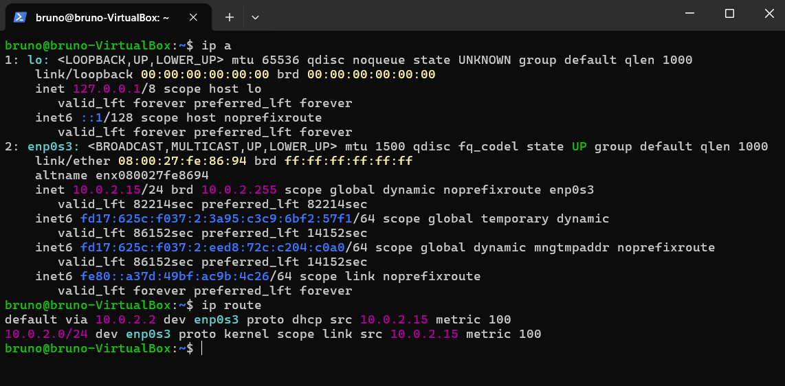
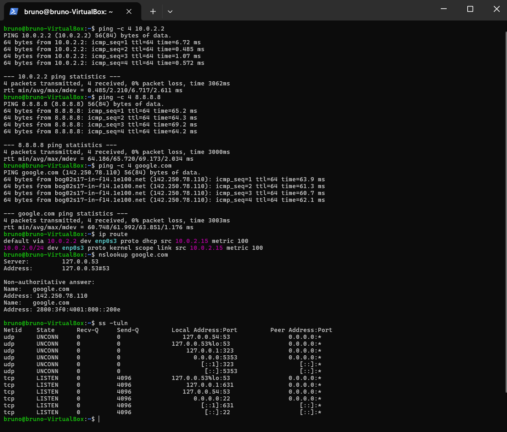

# Bloco 5: Rede no Linux

## Objetivo
Praticar o diagnóstico básico de rede no Linux, que é a base do atendimento de "estou sem internet": ver o IP e o gateway, testar a conexão do mais perto ao mais longe, conferir o DNS e ver quais portas estão abertas.

## Ambiente
- Ubuntu em uma máquina virtual (VirtualBox) no Windows 11, com a rede em modo NAT
- Acesso à VM por SSH, pelo PowerShell
- Usuário: `bruno`

## Comparação com o Windows
Eu já tinha feito um laboratório parecido no Windows. Estes são os comandos equivalentes:

| No Windows | No Linux |
|---|---|
| `ipconfig` | `ip a` |
| gateway mostrado no `ipconfig` | `ip route` |
| `ping` (envia 4 pacotes) | `ping -c 4` (no Linux o `ping` não para sozinho, por isso o `-c 4`) |
| `nslookup` | `nslookup` |
| `netstat -an` | `ss -tuln` |

## Parte A: IP e rota

```
ip a
ip route
```



| Comando | O que faz | O que apareceu |
|---|---|---|
| `ip a` | mostra as interfaces de rede e os IPs | a interface `lo` (loopback, `127.0.0.1`) e a interface `enp0s3`, com `state UP` e o IP `10.0.2.15/24` |
| `ip route` | mostra as rotas | `default via 10.0.2.2 dev enp0s3` e a rede `10.0.2.0/24` |

Trecho do resultado:
```
2: enp0s3: <BROADCAST,MULTICAST,UP,LOWER_UP> mtu 1500 ... state UP ...
    inet 10.0.2.15/24 brd 10.0.2.255 scope global dynamic noprefixroute enp0s3
...
default via 10.0.2.2 dev enp0s3 proto dhcp src 10.0.2.15 metric 100
10.0.2.0/24 dev enp0s3 proto kernel scope link src 10.0.2.15 metric 100
```

O que entendi:
- O IP da VM é `10.0.2.15`. O `/24` é a máscara `255.255.255.0`.
- O `dynamic` e o `proto dhcp` mostram que o IP foi entregue por DHCP (pelo VirtualBox).
- O **gateway** é o `10.0.2.2`, o endereço que aparece depois de `default via`.
- A interface `lo` (loopback) é o computador falando com ele mesmo, e não sai para a rede.

## Parte B: ping, DNS e portas

```
ping -c 4 10.0.2.2
ping -c 4 8.8.8.8
ping -c 4 google.com
nslookup google.com
ss -tuln
```



### Testes de conexão, do mais perto ao mais longe

| Teste | Resultado | O que prova |
|---|---|---|
| `ping -c 4 10.0.2.2` (gateway) | 4 enviados, 4 recebidos, 0% de perda, média de 2,2 ms | a VM alcança a rede local |
| `ping -c 4 8.8.8.8` | 0% de perda, média de 65,7 ms | a VM chega à internet |
| `ping -c 4 google.com` | 0% de perda, média de 62 ms, nome resolvido para `142.250.78.110` | o DNS está funcionando |

- O `-c 4` envia só 4 pacotes. Sem ele, o `ping` no Linux não para sozinho.
- O tempo do gateway (menos de 7 ms) é bem menor que o da internet (60 a 69 ms), porque o destino está mais longe.
- Na linha final, `rtt min/avg/max/mdev` mostra o menor, o médio e o maior tempo, e a variação entre eles.

### DNS
```
$ nslookup google.com
Server:         127.0.0.53
Address:        127.0.0.53#53

Non-authoritative answer:
Name:   google.com
Address: 142.250.78.110
Name:   google.com
Address: 2800:3f0:4001:800::200e
```
- O nome `google.com` foi traduzido para um IP v4 (`142.250.78.110`) e um IP v6.
- O servidor que respondeu foi o `127.0.0.53`, um serviço de DNS local da própria VM, que repassa as consultas.
- `Non-authoritative answer` quer dizer que a resposta veio de um servidor intermediário, e não do servidor oficial do domínio. É normal.

### Portas abertas
```
$ ss -tuln
tcp  LISTEN  0  4096  0.0.0.0:22     0.0.0.0:*
tcp  LISTEN  0  4096  [::]:22        [::]:*
tcp  LISTEN  0  4096  127.0.0.1:631  0.0.0.0:*
...
```
- O `ss -tuln` lista as portas em que o computador está escutando: `t` (TCP), `u` (UDP), `l` (só as que escutam) e `n` (números, sem nomes).
- A porta **22** é o **SSH**, o meu acesso remoto. Ela aparece em `0.0.0.0` e em `[::]`, ou seja, aceita conexões de fora da VM.
- Os endereços `127.x.x.x` (como `127.0.0.53:53` e `127.0.0.1:631`) só aceitam conexões da própria VM.
- A porta `53` é o DNS local, a `631` costuma ser do serviço de impressão e a `5353` costuma ser a descoberta de dispositivos na rede.

## Como uso isso no diagnóstico de "sem internet"
1. `ip a`: a interface está `UP` e tem IP?
2. `ip route`: existe uma rota `default via`?
3. `ping` no gateway: a rede local funciona?
4. `ping` no `8.8.8.8`: chega à internet?
5. `ping` no nome: o DNS funciona?

Se um passo falhar, o problema está naquele ponto: sem IP é a placa ou o DHCP, sem resposta do gateway é a rede local, sem o `8.8.8.8` é a internet, e se só o nome falha é o DNS.

## Erros que apareceram e como resolvi

**Troquei `ping` por `ip` ao digitar o comando.**
- O que fiz: digitei `ip -c 4 10.0.2.2` e `ip -c 4 google.com`.
- O que aconteceu: o terminal respondeu `Object "4" is unknown, try "ip help"`.
- Por que: no `ping`, o `-c 4` significa "envie 4 pacotes", mas no `ip` o `-c` significa "use cores", e o `4` ficou sem sentido.
- Como resolvi: reli o comando, vi que o primeiro nome estava errado e usei `ping -c 4`.
- Lição: conferir o nome do comando antes de apertar Enter.

## O que aprendi
Neste bloco aprendi a diagnosticar a rede no Linux. O `ip a` mostra o IP, o `ip route` mostra o gateway, o `ping` testa a conexão do mais perto ao mais longe (gateway, internet e DNS), o `nslookup` mostra a resolução de nomes e o `ss -tuln` mostra as portas abertas, como a 22 do SSH. Aprendi que no Linux o `ping` não para sozinho e que precisa do `-c`. Vi que os comandos são diferentes dos do Windows, mas a lógica de diagnóstico é a mesma. É o que um suporte N1 faz quando o usuário diz que está sem internet.
